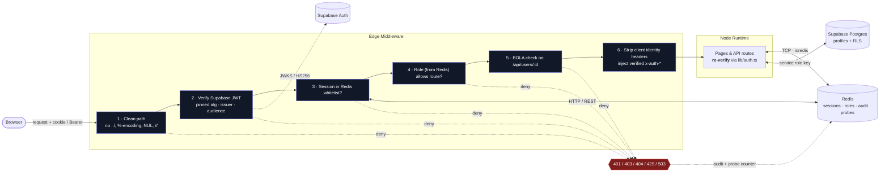
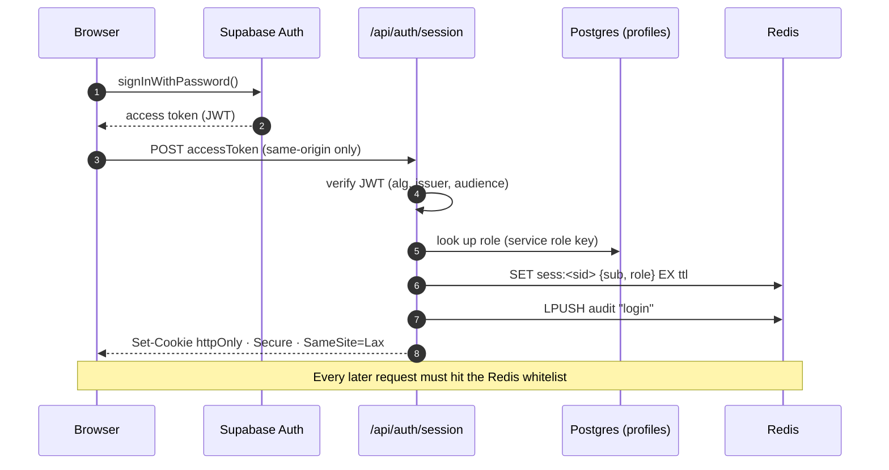

<div align="center">

# RBAC Session Auditor

**Role-based access control for Next.js, done the careful way.**
Every request is checked against a Supabase login *and* a Redis session whitelist.
Three roles. Instant revocation. A plain-English audit log of everything that gets denied.

<br />

[](https://auth.afthyir.co.uk)

[](https://nextjs.org)
[](https://www.typescriptlang.org)
[](https://react.dev)
[](https://tailwindcss.com)
[](https://supabase.com)
[](https://redis.io)
[](https://docs.docker.com/compose/)
[](https://vercel.com)

[](LICENSE)
[](#security-choices)
[](#security-choices)
[](#contributing)

[**Live Demo**](https://auth.afthyir.co.uk) · [**Architecture**](#architecture) · [**Quick Start**](#quick-start) · [**Security**](#security-choices)

</div>

---

## Why this exists

Most RBAC demos check a role in a client component and call it a day. This one assumes the client is hostile and the middleware might be bypassed, then layers defenses so a single mistake doesn't become a breach.

| Feature | What it means |
|---|---|
| **Three enforced roles** | Guest, Engineer and Admin, enforced in Edge middleware, not client-side code. |
| **Instant revocation** | Sessions live in a Redis whitelist, so a valid-looking JWT stops working the moment its session is revoked. |
| **Live role changes** | The role is read from Redis on every request. An admin's change applies on the user's next click. |
| **Readable audit log** | Logins, logouts, role changes, revocations and every denied request, written as plain sentences. |
| **BOLA protection** | `/api/users/:id` only returns your own profile unless you're an admin, and "not yours" looks identical to "doesn't exist". |
| **Hidden routes** | `/admin` and `/engineer` return `404` to people without access, so they can't tell the pages exist. |

> *"User 3f2a9c1d (guest) tried to open /admin from 203.0.113.7 - access denied"*
> — a real line from the audit log.

---

## Architecture



### Login flow



### Two Redis clients, on purpose

Next.js Edge Middleware can't open raw TCP sockets, so the project uses two clients against the same datastore:

| Runtime | Client | Transport | Used for |
|---|---|---|---|
| Edge (middleware) | `lib/redis-edge.ts` | HTTP `fetch()` (Upstash-compatible REST) | Session lookup, probe counting, audit writes |
| Node (pages, routes) | `lib/redis.ts` | TCP via `ioredis` | Create / revoke sessions, role updates, reading the audit log |

Locally the REST gateway is the `redis-rest` container. In production, point `REDIS_REST_URL` at [Upstash](https://upstash.com) or any compatible gateway.

---

## Security choices

- **Default deny.** Any route not on the public list needs a session.
- **Fail closed.** If Redis can't be reached, the answer is `503`, never "let them through".
- **Pinned JWT algorithms** (`HS256` or `ES256`/`RS256`), with issuer and audience checked, so forged or re-purposed tokens fail.
- **No trusting the client.** Identity headers sent by the browser are stripped before the verified ones are added. Roles come from the database, never from the request.
- **Second check inside the app.** Pages and API routes verify the session again, in case the middleware is ever bypassed.
- **Tokens stay out of JavaScript.** The session token lives in an `httpOnly` cookie, and state-changing routes check the request origin.
- **Path hardening.** Double encoding, NUL bytes, backslashes, `//` and `../` are rejected before routing.
- **Rate limiting** on repeated denied requests, per IP (20 denials per 5 minutes, then `429`).
- **Safe Redis keys.** IDs are validated as UUIDs before being placed in a key, so user input can't smuggle in extra key segments.
- **Locked-down headers.** CSP, HSTS, `X-Frame-Options: DENY`, `nosniff`, strict referrer and permissions policies.
- **Hardened Redis container.** Loopback-only, password-protected, read-only filesystem, all capabilities dropped, `FLUSHALL`/`FLUSHDB`/`DEBUG` disabled.
- **No stack traces or failure reasons** in responses, and no secrets in the repo.
- **RLS on, no policies.** The browser's anon key can't touch the `profiles` table; only the server can.

### Roles and routes

| Route | Minimum role | Unauthorized response |
|---|---|---|
| `/`, `/login`, `/api/health` | Public | n/a |
| `/dashboard` | Guest | `401` / redirect to `/login` |
| `/api/users/:id` | Guest (own ID) / Admin (any) | `404` |
| `/engineer`, `/api/engineer/*` | Engineer | `404` |
| `/admin`, `/api/admin/*` | Admin | `404` |

---

## Quick Start

### Prerequisites

- **Node.js 20+**
- **Docker** (for local Redis)
- A free **[Supabase](https://supabase.com)** project

### 1. Clone and install

```bash
git clone https://github.com/afthyir/rbac-session-auditor.git
cd rbac-session-auditor
npm install
```

### 2. Create the database table

Open the Supabase **SQL editor** and run [`supabase/schema.sql`](supabase/schema.sql). It creates the `profiles` table (with RLS) and a trigger that gives every new user the `guest` role.

### 3. Configure your environment

Create `.env.local` in the project root:

```bash
# ── Supabase ──────────────────────────────────────────────
NEXT_PUBLIC_SUPABASE_URL=https://<project-ref>.supabase.co
NEXT_PUBLIC_SUPABASE_ANON_KEY=<anon key>
SUPABASE_URL=https://<project-ref>.supabase.co
SUPABASE_SERVICE_ROLE_KEY=<service role key>      # server only, never expose
SUPABASE_JWT_SECRET=<optional: legacy HS256 secret> # omit to verify via JWKS

# ── Redis (local Docker) ──────────────────────────────────
REDIS_PASSWORD=<a long random string>
REDIS_URL=redis://default:<REDIS_PASSWORD>@127.0.0.1:6379
REDIS_REST_URL=http://127.0.0.1:8079
REDIS_REST_TOKEN=<another long random string>

# ── Optional ──────────────────────────────────────────────
SESSION_TTL_SECONDS=3600   # max 86400; never outlives the Supabase token
```

<details>
<summary><b>What each variable does</b></summary>

| Variable | Used by | Purpose |
|---|---|---|
| `NEXT_PUBLIC_SUPABASE_URL` / `_ANON_KEY` | Browser | Sign-in from the login page |
| `SUPABASE_URL` | Server + Edge | JWT issuer check and JWKS location |
| `SUPABASE_SERVICE_ROLE_KEY` | Server only | Reading and writing roles (bypasses RLS) |
| `SUPABASE_JWT_SECRET` | Server + Edge | Optional. If set, tokens are verified with `HS256`; otherwise via JWKS |
| `REDIS_PASSWORD` | Docker | Password for the local Redis container |
| `REDIS_URL` | Node runtime | TCP connection (`rediss://` enables TLS) |
| `REDIS_REST_URL` / `_TOKEN` | Edge middleware | HTTP gateway to the same Redis |
| `SESSION_TTL_SECONDS` | Server | Redis session lifetime |

</details>

### 4. Start Redis and the app

```bash
npm run redis:up   # Redis + REST gateway, bound to 127.0.0.1
npm run dev        # http://localhost:3000
```

Check it's healthy: `curl http://localhost:3000/api/health` → `{"ok":true}`

### 5. Make yourself the first admin

Sign up through the login page, then run this in the Supabase SQL editor:

```sql
update public.profiles set role = 'admin'
where id = (select id from auth.users where email = 'you@example.com');
```

Sign out and back in, and `/admin` will open for you.

---

## Scripts

| Command | What it does |
|---|---|
| `npm run dev` | Start the dev server |
| `npm run build` | Production build |
| `npm start` | Run the production build |
| `npm run typecheck` | Type-check with `tsc --noEmit` |
| `npm run redis:up` | Start local Redis + REST gateway |
| `npm run redis:down` | Stop them |

---

## Project layout

```
src/
├── middleware.ts            ← the gatekeeper (Edge)
├── lib/
│   ├── session-schema.ts    roles, Redis keys, audit event types
│   ├── verify-token.ts      Supabase JWT verification (Edge + Node)
│   ├── redis-edge.ts        Redis over HTTP (middleware)
│   ├── redis.ts             Redis over TCP (sessions, revoke, audit log)
│   ├── supabase-admin.ts    role lookups with the service role key
│   ├── auth.ts              second check for pages and API routes
│   └── request.ts           client IP + same-origin check
└── app/
    ├── login/  dashboard/  engineer/  admin/
    └── api/
        ├── auth/{session,logout}
        ├── users/[id]       ← BOLA example
        ├── admin/{audit,revoke,role}
        └── health
supabase/schema.sql          profiles table + new-user trigger
docker-compose.yml           hardened local Redis + REST gateway
```

---

## Deploying

1. Push to GitHub and import the repo into **[Vercel](https://vercel.com)**.
2. Create an **[Upstash Redis](https://upstash.com)** database. Use its TCP URL for `REDIS_URL` and its REST URL/token for `REDIS_REST_URL` / `REDIS_REST_TOKEN`.
3. Add every variable from the table above to your Vercel project settings.
4. Deploy.

---

## Known limits

- Sessions last as long as the Supabase access token (an hour by default) and there is no refresh flow.
- Rate limiting only counts denied requests. A real deployment would add a CAPTCHA on sign-up.
- The CSP allows inline scripts, because Next.js needs them without extra nonce setup.
- It stays on **Next.js 15** on purpose: version 16 moved middleware off the Edge runtime.

---

## Contributing

Issues and pull requests are welcome. Please run `npm run typecheck` before opening a PR, and keep the security posture intact: default deny, fail closed, and no trusting the client.

## License

Released under the [MIT License](LICENSE) © 2026 afthyir.

<div align="center">

**If this helped you think about access control, consider leaving a star**

</div>
