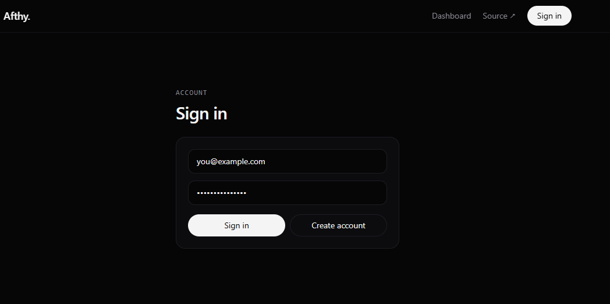
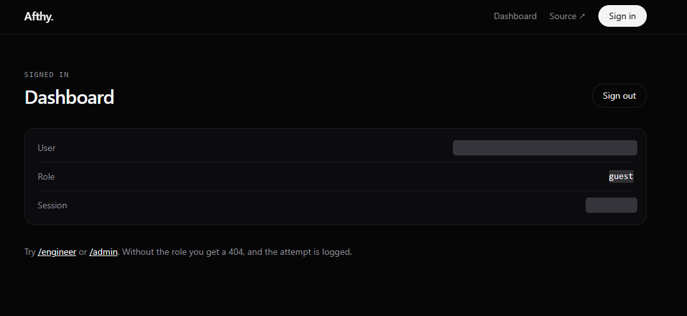
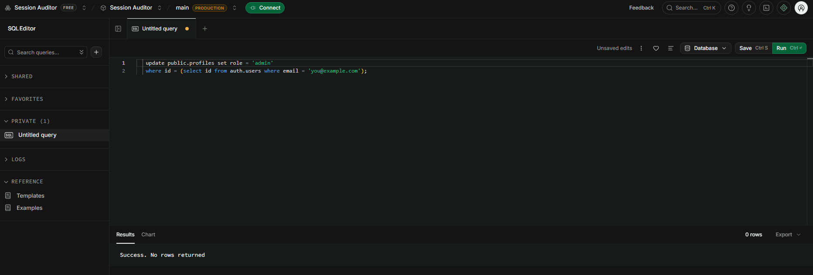
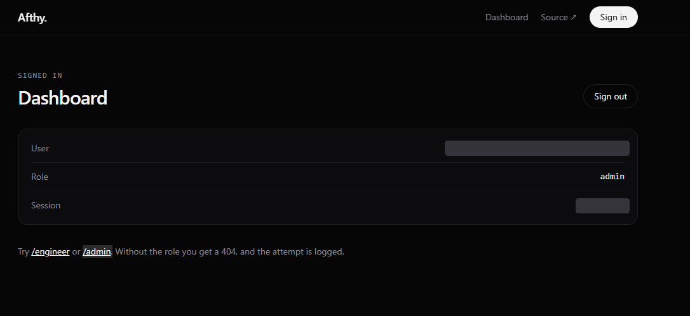
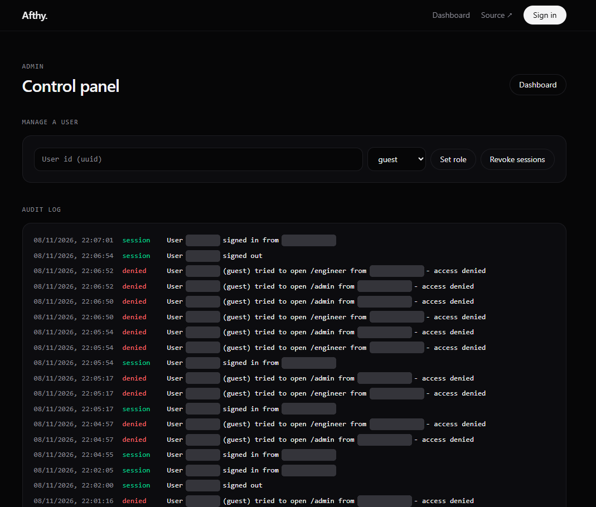

# Walkthrough: roles, access and the audit log

This guide takes you through the whole project in about five minutes: sign in as a guest, get blocked, promote yourself to admin, and watch every step land in the audit log.

You can follow it on the live demo at https://auth.afthyir.co.uk or on your own copy (see "Run it yourself" in the README). Promoting yourself in step 3 needs access to the Supabase project behind the app, so on the public demo you will stay a guest unless you are running your own instance.

The three roles are `guest`, `engineer` and `admin`. A new account starts as `guest`.

Screenshots have user IDs, session IDs and IP addresses hidden.

---

## 1. Create an account and sign in

Open the sign-in page, enter an email and password, and press **Create account**. After that, **Sign in** takes you straight to the dashboard.



Behind the scenes, Supabase checks the password and the app opens a session. That session is stored in a Redis whitelist, and the token lives in an httpOnly cookie so JavaScript on the page can never read it.

## 2. Look around as a guest

The dashboard shows who you are: your user ID, your role and a shortened session ID. A fresh account is a `guest`.



Now try the two links at the bottom, `/engineer` and `/admin`. You get a **404**, not a "forbidden" page. That is on purpose: someone without the role should not even be able to tell those pages exist. The attempt is still written to the audit log, which you will see in step 5.

## 3. Promote yourself in Supabase

The very first admin has to be created outside the app, because the admin panel itself needs the admin role.

1. Open your project in the Supabase dashboard.
2. Go to **SQL Editor** and create a new query.
3. Paste the query below, swap in the email you signed up with, and press **Run**.

```sql
update public.profiles set role = 'admin'
where id = (select id from auth.users where email = 'you@example.com');
```



"Success. No rows returned" is the normal message for an `update` in the SQL editor, so it does not tell you whether a row was changed. To check, run:

```sql
select id, role from public.profiles
where id = (select id from auth.users where email = 'you@example.com');
```

The role you can set is one of three values:

| Value | Meaning |
| --- | --- |
| `guest` | Default. Can sign in and see the dashboard only. |
| `engineer` | Can open `/engineer`. |
| `admin` | Can open `/admin` and manage other users. |

Change `'admin'` in the first query to `'engineer'` or `'guest'` to try the other roles.

## 4. Sign out and sign in again

Press **Sign out** on the dashboard, then sign in again with the same account. The dashboard now shows the new role.



The session ID is different from before, because signing in creates a new session. The old one was removed when you signed out.

If you still see `guest`, you are probably still on the old session. Sign out fully, sign in again, and check the select query from step 3 to confirm the database row changed.

## 5. Use the admin panel and read the audit log

Open `/admin`. As an admin you now get the control panel instead of a 404.



**Manage a user.** Paste a user ID (the one shown on that person's dashboard), pick a role and press **Set role** to change it, or press **Revoke sessions** to log that user out everywhere. Revocation is immediate, because a token only works while its session is in the Redis whitelist.

**Audit log.** Every important event is written as a plain sentence, newest first:

- `session` entries (green) are sign-ins and sign-outs.
- `denied` entries (red) are requests that were blocked, with the user's role, the page they tried and where it came from.

In the screenshot you can see the exact sequence from this guide: a guest signing in, repeatedly being denied on `/admin` and `/engineer`, then signing out and signing in again after the role change.

---

## Things to try next

- Set a second account to `engineer`, and check that `/engineer` opens but `/admin` still returns a 404.
- Sign in on two browsers, then use **Revoke sessions** on that user and refresh both. Both should be signed out on the next request.
- Change a user's role with **Set role** in the admin panel while they are signed in, and see how it affects their next click.
- Try opening `/api/users/<someone else's id>` as a guest. It should look exactly like a user that doesn't exist.

## If something looks wrong

| What you see | Likely cause |
| --- | --- |
| Still a guest after the SQL update | You are on the old session. Sign out, sign in again, and run the select query to confirm the row changed. |
| `/admin` returns 404 for your admin account | The email in the SQL query didn't match your account, so no row was updated. Check it with the select query. |
| Pages that need a session return 503 | The app can't reach Redis and is failing closed on purpose. Start Redis (`npm run redis:up`) or check the Redis URL in `.env.local`. |
| Sign-in fails | Check the Supabase URL and keys in `.env.local`, and that you ran `supabase/schema.sql` first. |
